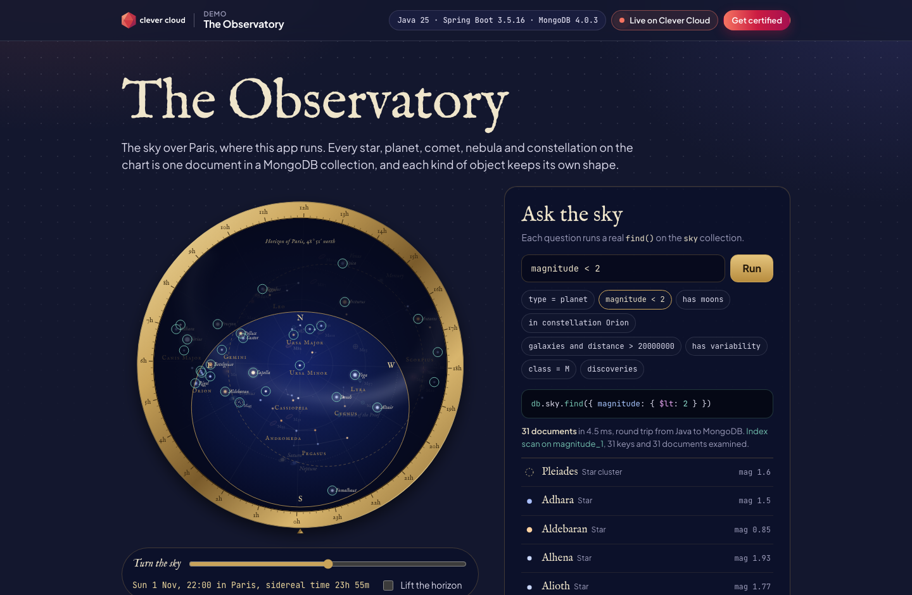

# The Observatory — Java + MongoDB on Clever Cloud

> A planisphere of the sky over Paris, where this app runs. Every star, planet, comet, nebula, galaxy, cluster and constellation on the chart is **one MongoDB document**, and each kind keeps its own shape: a star has a magnitude and a spectral class, a planet an array of moons, a comet an orbital period and a last perihelion, a nebula nested coordinates, a constellation an array of star references. Ask the sky a question and the page shows the real filter document, the time it took and the server's plan. Log a discovery and watch the inserted document come back with its `ObjectId`. Spring Boot on the Clever Cloud Java runtime, MongoDB add-on, dressed in the **Clever Brand Kit**.



**Run it yourself.** The hosted demo was taken down after the presales review (November 2026). The steps in [Deploy on Clever Cloud](#deploy-on-clever-cloud) recreate it from scratch in about 15 minutes (the Maven build runs the tests, and the MongoDB add-on takes a few minutes to provision).

**Get certified.** This demo runs on Clever Cloud. To deploy your own apps the same way, get certified at the [Clever Cloud Academy](https://academy.clever.cloud/).

---

## What MongoDB does in this demo

| On the page | MongoDB operation |
|---|---|
| The chart (119 objects) | `find({})` on the `sky` collection, documents returned as Extended JSON |
| **Ask the sky** (`type = planet`, `magnitude < 2`, `has moons`, `in constellation Orion`…) | the words become a filter document, then `find(filter)`, timed, plus `explain("executionStats")`: *index scan on `magnitude_1`* or *collection scan* |
| Click any object | `find({_id})`: the human view on one side, the raw document in mongosh notation on the other |
| Click a constellation | an aggregation with `$lookup` resolves its array of star `ObjectId`s |
| **Census of the catalogue** | `aggregate([{$group: {_id: "$type", count: {$sum: 1}}}, {$sort: …}])` |
| **Log a discovery** | server-side validation per type, `insertOne`, then the document is read back as stored |
| Startup | idempotent seed (unique `slug` index), indexes on `type` and `magnitude` |

`in constellation Orion` is the clearest example of the document model: stars carry a top-level `constellation`, Messier objects carry it inside `coordinates`, so the filter is an `$or` over both shapes.

Planets have no fixed position: their documents hold the JPL orbital elements in an `orbit` sub-document, and the browser computes where they are tonight (and where Earth is, from Earth's own document).

---

## Deploy on Clever Cloud

You need [clever-tools](https://www.clever.cloud/developers/doc/cli/) (`clever login` done) and the ID of the organisation that will own the resources (`orga_…`, shown in the Console). Run the commands from the repo root: `clever create` links the folder to the new app.

```bash
# 1. The app and its size: XS, a JVM with Spring Boot is too tight on nano
clever create --type maven demo-java-mongodb --region par --org <org_id>
clever scale --min-flavor XS --max-flavor XS --min-instances 1 --max-instances 2
clever scale --build-flavor M

# 2. MongoDB (dedicated xs_sml, encrypted at rest), linked to the app
clever addon create mongodb-addon demo-java-mongodb-db --plan xs_sml --region par --org <org_id> --option encryption=true --yes
clever service link-addon demo-java-mongodb-db

# 3. Variables
clever env set CC_JAVA_VERSION 25
clever env set CC_RUN_COMMAND "java -XX:MaxRAMPercentage=60 -jar target/observatory.jar"
clever env set CC_HEALTH_CHECK_PATH /health

# 4. Deploy
clever deploy
clever open
```

Clever Cloud builds with `mvn package` (the tests run during the build), then starts the Spring Boot jar. There is no secret to generate and no setup script: at first start the app creates its indexes and seeds the 119 catalogue objects (idempotent). `GET /health/deep` pings MongoDB and counts the documents.

### Variables

| Variable | Value | Role |
|---|---|---|
| `CC_JAVA_VERSION` | `25` | JDK used for the build and at runtime (the runtime default is 21) |
| `CC_RUN_COMMAND` | `java -XX:MaxRAMPercentage=60 -jar target/observatory.jar` | starts the jar built by `mvn package` |
| `CC_HEALTH_CHECK_PATH` | `/health` | deployment validated on a route that does not need the database |
| `MONGODB_ADDON_URI` | injected by the add-on | read by `spring.data.mongodb.uri`, never copied |

### A note on the MongoDB driver

The Clever Cloud MongoDB add-on runs **MongoDB 4.0.3**. MongoDB Java drivers 5.5 and later require MongoDB 4.2 (wire version 8), so the `pom.xml` pins `mongodb.version` to **5.4.0**, the last driver that still talks to 4.0. This is also why the app uses Spring Boot 3.5 rather than 4.x (built on driver 5.6+).

---

## Routes

`GET /` (the page), `GET /api/sky`, `GET /api/objects/{id}`, `GET /api/query?q=…`, `GET /api/census`, `POST /api/discoveries`, `GET /api/platform`, `GET /health` (no database), `GET /health/deep` (ping, server version, document count).

Visitor discoveries are capped at 40: past that, the oldest one is removed before the new insert.

---

## Run locally

```bash
./mvnw test                                   # 16 tests, no database needed
MONGODB_ADDON_URI="mongodb://localhost:27017/observatory" ./mvnw spring-boot:run
```

Requires Java 25. Without `MONGODB_ADDON_URI`, the app uses `mongodb://localhost:27017/observatory`.

---

## Project structure

```
src/main/java/cloud/clever/observatory/
  SkyController.java      → the JSON API: find, $lookup, $group, insertOne (Extended JSON responses)
  SkyQuery.java           → plain words → MongoDB filter document
  QueryPlan.java          → reads IXSCAN / COLLSCAN out of explain()
  Discovery.java          → sealed interface + one record per type, validated with Bean Validation
  SkySeeder.java          → idempotent seed from catalog.json, star slugs → ObjectId references
  HealthController.java   → /health and /health/deep
  PlatformController.java → the "Running on Clever Cloud" panel (whitelisted variables only)
src/main/resources/
  catalog.json            → 119 objects: 71 bright stars, 22 Messier objects, 8 planets, 6 comets, 12 constellations
  static/                 → index.html, sky.css, app.js (planisphere, ephemerides, query bar), Clever Brand Kit
```

The astronomical values are public-domain catalogue facts (J2000 positions, magnitudes, spectral classes, distances, JPL approximate orbital elements), rounded.
